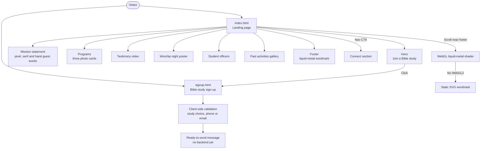
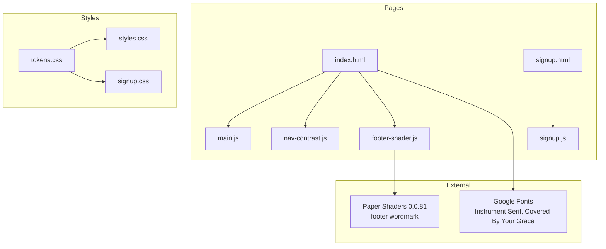
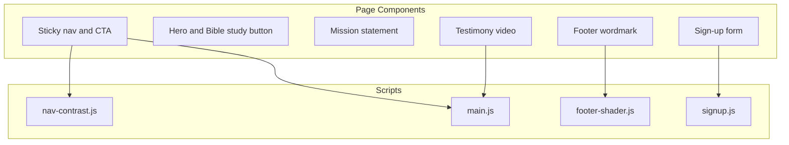

# *DRINC* landing page

A static website for **Deeper Roots in Christ (DRINC)**, a Christian student club at the University of Illinois Chicago. It introduces the club with a mission statement, programs, a testimony, student officers and a photo gallery, and it has a sign-up page for joining a Bible study. The footer uses a liquid-metal wordmark rendered in WebGL.

**Live site**: [https://hoangngo-sudo.github.io/drinc/](https://hoangngo-sudo.github.io/drinc/)

## Architecture



## Features

- **Mission statement**: one sentence set in Allo, with three guest faces. "bible" is pixel, "Jesus" is serif italic, and "love" is hand-lettered. The welcome sticker closes the sentence.
- **Liquid-metal footer wordmark**: a liquid-metal shader draws the wordmark. It starts only when the footer nears the viewport, or once the page is idle after load. It stops for visitors with reduced motion, and falls back to a static SVG where WebGL2 is unavailable.
- **Floating call-to-action**: the Connect button hands off to the footer and parks there, so it never covers the wordmark.
- **Nav contrast**: the nav button flips between light and dark, depending on what is behind it.
- **Lazy video**: the testimony video loads as it approaches the screen.
- **Sign-up validation**: the submit button is greyed out until the form is valid. Each field gets its own error message and `aria-invalid` state.
- **Reduced motion**: smooth scrolling, transitions and the shader all respect `prefers-reduced-motion`.
- **Responsive layouts**: desktop and phone each have their own layout.
- **Design tokens**: colour, type, spacing and radius are CSS custom properties in `css/tokens.css`.

## Tech Stack



| Dependency | Purpose |
|---|---|
| Vanilla HTML5 / CSS3 / ES2015+ | Core |
| [Paper Shaders](https://paper.design/) 0.0.81 | Liquid-metal footer wordmark, vendored into `vendor/paper-shaders` |
| Allo (self-hosted) | Display and UI type, SIL OFL |
| Geist Pixel (self-hosted) | Pixel guest word in the mission statement, SIL OFL |
| Instrument Serif, Covered By Your Grace | Guest words in the mission statement, Google Fonts |
| GitHub Pages | Static hosting |

## Run Locally

Open the site through a static server rather than double-clicking `index.html`. Browsers block ES modules over `file://`, so without a server the footer shader falls back to the static wordmark and some assets may not load.

### Option 1: Live Server in VS Code (easiest)

First time only, install the extension:

1. Open VS Code.
2. Open the Extensions view: click the squares icon in the left sidebar, or press `Ctrl+Shift+X` (`Cmd+Shift+X` on macOS).
3. Search for **Live Server** by Ritwick Dey and click **Install**.

Then, every time:

1. Open the repo folder in VS Code (**File → Open Folder…** and pick the `drinc` folder).
2. Open `index.html`.
3. Click **Go Live** in the status bar at the bottom right, or right-click `index.html` and choose **Open with Live Server**.

Your browser opens at `http://127.0.0.1:5500/index.html`. The page reloads when you save a file. To stop the server, click **Port: 5500** in the status bar.

### Option 2: From a terminal

From the repo folder, run one of these, then open the address it prints:

```bash
npx serve .
```

```bash
python -m http.server 8000
```

With Python, the site is at `http://localhost:8000/`. Press `Ctrl+C` to stop either server.

## Project Structure

```
.
├── index.html              # Landing page
├── signup.html             # Bible study sign-up
├── css/
│   ├── tokens.css          # Design tokens and the Allo @font-face
│   ├── styles.css          # Landing page styles
│   └── signup.css          # Sign-up styles
├── js/
│   ├── main.js             # Lazy video, floating CTA, gallery
│   ├── nav-contrast.js     # Nav CTA flips to match the backdrop
│   ├── footer-shader.js    # Liquid-metal wordmark (WebGL, ES module)
│   └── signup.js           # Sign-up validation
├── assets/
│   ├── fonts/              # Allo, Geist Pixel and their licences
│   ├── icons/              # Favicons, app icons, push pin
│   ├── img/                # Photos, posters, logo, wordmark textures
│   └── video.mp4           # Testimony video
├── vendor/paper-shaders/   # Vendored shader modules used by the footer
├── .github/workflows/
│   └── static.yml          # GitHub Pages deployment
├── .nojekyll               # Serve files as-is on GitHub Pages
├── robots.txt
├── sitemap.xml
└── favicon.ico
```

## JS Module Map



## Accessibility

- A skip link jumps to the main content.
- Decorative images and the wordmark are hidden from screen readers. The nav brand link has its own label.
- Smooth scrolling, transitions and the shader respect `prefers-reduced-motion`.

## Acknowledgement
- All graphics and contents are credited to [Grace Min](https://www.instagram.com/gmin_design/), our UIC alumni

## License

MIT. See [LICENSE](LICENSE).

The Allo and Geist Pixel fonts are under the SIL Open Font License; their licence files sit in `assets/fonts/`.
